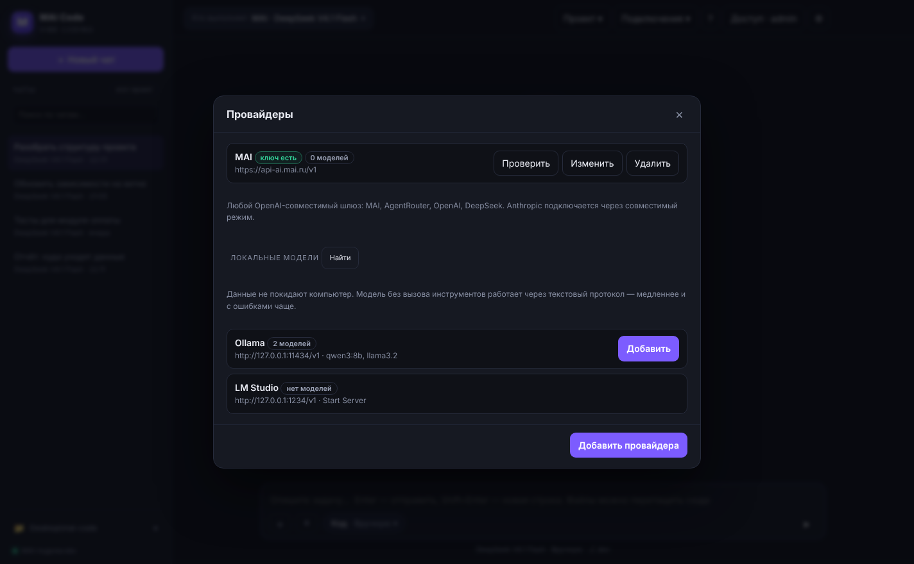

# MAI - My AI

Десктопный агент для вайбкодинга на моделях [MAI](https://api-ai.mai.ru) — собственный чат-клиент
на Electron с инструментами для работы с файлами, `AGENTS.md`, навыками, MCP-серверами и плагинами.


> Как работать с приложением каждый день — [руководство пользователя](docs/USER-GUIDE.md):
> режимы разрешений, карточки в ленте, команды, контекст, откат, субагенты, хуки.
> Что изменилось в 0.2.0 — [CHANGELOG](CHANGELOG.md#020--2026-11-20).

## Возможности

- **Модели MAI** — список подтягивается из `GET /v1/models`, в дропдауне только чат-модели
  с человеческими названиями и размером контекста.
- **Несколько провайдеров** — MAI, AgentRouter и любой другой OpenAI-совместимый шлюз
  (OpenAI, DeepSeek, Anthropic в режиме совместимости). Модели в дропдауне сгруппированы
  по провайдерам и записываются как `провайдер/модель`, у каждого свой ключ и кэш моделей.
- **Внешние рантаймы** — OpenCode, herdr и любая своя команда: процесс запускается в папке
  проекта, вывод стримится в чат, есть кнопка «Остановить» и шаблоны `{prompt}`, `{model}`,
  `{projectDir}`, `{target}`.
- **Чат с агентом** — потоковые ответы, блок «Размышления», история чатов, переключение сессий,
  остановка генерации, вложения файлов кнопкой «+» или перетаскиванием.
- **Голосовой ввод** — кнопка микрофона записывает фразу и вставляет текст в поле ввода.
  Распознавание выполняет локальный MAS (токен читается автоматически) или провайдер
  (`audio/transcriptions`, например Whisper); ошибка видна на кнопке, «↻» повторяет
  ту же запись (ADR 0092).
- **Инструменты агента**:
  - `read_file`, `list_files`, `grep` — чтение проекта;
  - `write_file`, `edit_file` — правки;
  - `run_shell` — команды в папке проекта (таймаут 180 с) в оболочке из настроек:
    по умолчанию cmd.exe на Windows, bash/zsh/sh на macOS и Linux, можно PowerShell (ADR 0096);
  - `load_skill` — загрузка навыка по имени;
  - `ocr` — текст с картинки и скана PDF (ADR 0084);
  - `notebook_edit` — ячейки Jupyter; `diagnostics` — ошибки компилятора и линтера
    проекта; `tool_search` — схемы MCP по запросу, когда их много (ADR 0079);
  - `mcp__<server>__<tool>` — инструменты MCP-серверов; ресурсы — `@server:uri`,
    промпты — `/mcp__server__prompt`, транспорты stdio, streamable HTTP и SSE (ADR 0071);
  - инструменты из плагинов.
- **Режимы разрешений** — «Вручную», «Принимать правки», «План», «Только
  разрешённое», «Без вопросов» и правила `allow`/`ask`/`deny`. Проверка одна для
  всех инструментов, включая MCP и плагины (ADR 0027):

  | Режим | Чтение | Правка файла | Память | Команда | MCP / плагин |
  |---|---|---|---|---|---|
  | Вручную | да | спросить | спросить | спросить | спросить |
  | Принимать правки | да | да | спросить | спросить | спросить |
  | Авто | да | да (в проекте) | да | безопасные — да, рискованные — спросить | спросить |
  | План | да | нет | нет | нет | нет |
  | Только разрешённое | да | по правилу | по правилу | по правилу | по правилу |
  | Без вопросов | да | да | да | да | да |

  В режиме «План» агент сдаёт план карточкой: альтернативы, рекомендованная
  подсвечена, кнопка «Выполнить» сама переключает режим. Вопросы агент задаёт
  карточкой с вариантами (`ask_user`), рекомендованный выбирается по Enter.

  Guardrails и правила `deny` действуют во всех режимах. На запрос можно ответить
  «Да», «Да, и не спрашивать» (правило на чат, на проект только для себя или
  всегда) или «Нет» с пояснением для агента. Рекомендованный ответ подсвечен.
  Прерванная закрытием приложения работа продолжается кнопкой «Продолжить»
  (ADR 0051).
  Плановые задачи — `/schedule`: по расписанию, без вопросов, только по
  правилам (ADR 0050). Уведомления на рабочем столе и в мессенджеры — Telegram,
  MAX, WhatsApp, Rocket.Chat, webhook Slack/Discord/Teams: готово, нужно
  подтверждение, вопрос, ошибка (ADR 0081).
  Инструменты файлов: `glob`, `edit_file` с несколькими правками и
  `replace_all`; правка только после чтения; длинный вывод — в файл (ADR 0054);
  фоновые команды — `run_shell` с `background`, `shell_output`, `shell_kill` (ADR 0055);
  веб — `web_fetch`, `web_search` с правилами по домену и защитой от SSRF (ADR 0056);
  браузер агента — открыть, нажать, заполнить в отдельном окне, разрешения по
  сайтам, пароли и оплата — только пользователь (ADR 0069).
  При сбоях модели — повторы с уведомлением и запасная модель (ADR 0057);
  глубина рассуждений и флаги возможностей модели (ADR 0058); модели без tool
  calling — текстовый протокол, отдельная модель для «Плана» (ADR 0078).
  Git: `/commit`, `/review`, `/security-review`, `/signoff` (статус «тесты прошли» в GitHub, ADR 0097), `/pr` по шаблону репозитория, `/worktree` —
  чат в отдельной рабочей копии; пуш в защищённые ветки запрещён приложением (ADR 0059, 0076).
- **Куда уходят данные** — `/privacy`: облачные модели, плановые задачи, телеметрия,
  MCP, коннекторы, веб и мессенджеры по уровням и чек-лист «строго локально» (ADR 0098).
  Агент создаёт и читает Word, PowerPoint и Excel: `create_document` (DOCX и PDF из
  Markdown, PPTX из слайдов, XLSX с формулами), `read_document`; PDF — собрать,
  вырезать страницы, заполнить форму (ADR 0083); перед сдачей смотрит на документ картинкой — `preview_document`
  (ADR 0049, 0066, 0067, 0068).
  «📄 Результаты» — файлы, которые агент создал и изменил в чате (ADR 0047).
  Проекты — папки, инструкции, коннекторы и вид вместе, «Открыть» одним кликом
  (ADR 0065).
  Переключатель «Код / Задача»: во втором агент работает с документами и
  данными, без git и инструментов кода (ADR 0046).
  К чату можно добавить ещё папки («＋ папка» над полем ввода): агент видит их
  как `@имя/путь`, вне папок — ничего (ADR 0045).
  Прочитанное — данные: при признаках prompt injection «Авто» до конца ответа
  спрашивает про действия (ADR 0053).
  Отправка через коннекторы (письмо, сообщение, событие) спрашивается всегда, с
  превью (ADR 0048).
  Удаление — только `delete_file`, в корзину приложения (`/trash`), с вопросом
  во всех режимах, кроме «Без вопросов» (ADR 0044).
  Правила складываются с пяти уровней: организация (`managed-settings.json`,
  может запретить «Без вопросов»), пользователь, проект (`.mai-code/settings.json`
  в git), «только у меня» (`.mai-code/settings.local.json`), чат; `deny` с любого
  уровня сильнее всего. `/permissions` — правила по уровням и проверка «что
  будет с этой командой» (ADR 0038).
- **Диалог** — подтверждения, вопросы агента и план карточками в ленте, diff
  правок, живой вывод команд, очередь сообщений, список задач агента.
  `/` — команды (`/help` — список), `@` — файл проекта, Esc — стоп,
  Shift+Tab — режим. Свои команды — `.mai-code/commands/<имя>.md` с `$ARGUMENTS`.
  Индикатор и `/context` — заполнение контекста, с 80% ранняя часть сжимается в
  сводку (`/compact` вручную); `/cost` — токены и цена. Кнопка ↺ у сообщения
  откатывает правки агента и диалог к этому месту, ✎ — изменить сообщение и
  отправить заново. Чаты по умолчанию — текущего проекта, есть поиск по тексту и
  `/resume`; двойной Esc — точки отката, имя чата от модели или `/rename`, копия
  `/fork`, файл чата для переноса и `/import`, срок хранения (ADR 0073).
  `# правило` в поле ввода записывает строку в память, `!команда` выполняется
  без модели. Статусная строка, светлая/тёмная/системная тема, окна с
  клавиатуры (ADR 0074).
- **Песочница для команд** — `run_shell` в одноразовом Docker-контейнере:
  проект в `/workspace`, без сети и лишних прав, маски команд для хоста;
  включается в «Настройки» → «Команды агента» (ADR 0040).
- **Пакеты плагинов** — команды, агенты, навыки, плагины, хуки и MCP в одной
  папке с `mai-package.json`; установка из папки или git, выключение без
  удаления, `/packages` (ADR 0037). Каталоги пакетов из git с версиями и
  обновлениями (ADR 0042). Наборы по ролям (разработчик, аналитик, юрист,
  продажи, финансы) и мастер первого запуска, `/onboarding` (ADR 0070).
- **Набор сценариев** — `npm run eval`: 20 типовых задач с проверкой результата
  по профилям агента (модель, режим, правила), отчёт в `evals/reports/` (ADR 0082).
- **Без окна** — `mai -p "задача" --output json|stream-json` для скриптов и CI: те же
  ключи, правила и хуки; спросить некого — разрешения через `--allow` (ADR 0077).
- **Субагенты** — агент поручает подзадачу субагенту со своим контекстом
  (`explore`, `plan`, `calibrator`, `general` или свой тип из `.mai-code/agents/<имя>.md`) и
  получает только итог; разрешения — те же, что у чата. `/agents` — список.
  Правки субагента — в своём `git worktree` со слиянием по подтверждению,
  долгие подзадачи — в фоне с уведомлением (ADR 0075).
- **Инструкции проекта** — `AGENTS.md` с импортами `@путь`, личный `AGENTS.local.md`
  (не в git), `AGENTS.md` в подпапках — правила приходят агенту, когда он трогает
  файлы этой папки. Читаются и `CLAUDE.md`, `GEMINI.md`, правила Cursor и Copilot
  (без повторов); кэш промпта для Claude; дубли навыков видны (ADR 0080).
- **AGENTS.md** — проектный и глобальный, подмешиваются в системный промпт.
- **Навыки** — `<проект>/.mai-code/skills/<имя>/SKILL.md`, создание и удаление из интерфейса;
  вызов `/имя`, файлы рядом с `SKILL.md` агент читает по запросу, `allowed-tools`
  во frontmatter разрешает узкие правила на прогон (ADR 0043).
- **MCP** — локальные (stdio) и удалённые (streamable HTTP) серверы; глобальные
  настройки и проектный `<проект>/.mai-code/mcp.json`.
- **Плагины** — `<проект>/.mai-code/plugins/*.js`: свои инструменты и хук `transformMessages`.
  Исполняются в отдельном процессе без доступа к окнам, Electron API и переменным
  с ключами (ADR 0030); файлы проекта им доступны.
- **Встроенная документация** — GitBook-подобное окно: разделы, оглавление страницы,
  поиск по всем markdown-файлам, офлайн.
- **Docker-песочницы** — изоляция процессов и сети, лимиты CPU/RAM, публикация портов
  только на `127.0.0.1` по умолчанию.
- **Ревизор** — вторая модель проверяет ответ и возвращает `approve` или `revise`
  (механика Delamain), опционально.
- **OpenSpec + Multica** — задачи из `openspec/changes/*/tasks.md` синхронизируются
  в Multica через CLI, идемпотентно; закрытые в Multica возвращаются галочкой (ADR 0089).
- **Пресеты** — DeepSeek Harness (`dsh`), Hermes, JEV, Claude Code, Codex, Gemini.
- **Kubernetes** — манифесты для Keycloak, Postgres и Multica, путь переезда в облако.
- **Версионируемые артефакты** — навыки, `AGENTS.md`, OpenSpec, ADR, диаграммы, OpenAPI
  и заметки хранятся с историей версий, diff'ом и восстановлением в
  `<проект>/.mai-code/artifacts`.
- **Четыре доски в отдельных окнах** — доставка (канбан + Multica), архитектура
  (C1–C4, sequence, ER, deployment с sizing, OpenAPI, ADR, дрейф), рантаймы и деплой,
  качество и self-correction loop. Плюс окно «Хранилище».
- **Repowise** — локальный индекс кода через CLI, MCP и встроенные инструменты;
  дистилляция вывода shell сокращает расход токенов.
- **Изоляция путей** — инструменты работают только внутри папки проекта, пока не включён
  доступ вне проекта.

## Быстрый старт

Требования: Windows 10/11, Node.js 20+.

```powershell
git clone https://github.com/crruton/mai-code.git
cd mai-code
npm.cmd install
npm.cmd start
```

> В PowerShell `npm` может блокироваться политикой выполнения — используйте `npm.cmd`.
> Если npm 11 не запускает install-скрипты Electron:
> `npm.cmd install-scripts approve electron` и `npm.cmd rebuild electron`.

Ярлык на рабочем столе:

```powershell
powershell -ExecutionPolicy Bypass -File .\install-shortcut.ps1
```

### Ключи и адреса шлюзов

При первом запуске приложение ищет ключ в таком порядке:

1. `%APPDATA%\mai-code\.env`;
2. `%USERPROFILE%\Desktop\dev\.env`;
3. `<папка приложения>\.env`;
4. `mai-api-key.txt` рядом с проектом;
5. переменные окружения процесса.

Формат `.env` — обычный `KEY=value`, также поддерживается табуляция (`KEY\t=value`):

```dotenv
LLM_BASE_URL=https://api-ai.mai.ru/v1
LLM_MODEL=deepseek-v4.1-flash
LLM_API_KEY=sk-...
AGENTROUTER_BASE_URL=https://agentrouter.org/v1
AGENTROUTER_MODEL=claude-opus-5-5
AGENTROUTER_API_KEY=sk-...
```

Из `LLM_*` создаётся провайдер MAI, из `AGENTROUTER_*` — провайдер AgentRouter.
Дальше ключи и адреса правятся в панели «Провайдеры» и хранятся в `%APPDATA%\mai-code\settings.json`.

| Параметр | Значение по умолчанию |
|---|---|
| Base URL | `https://api-ai.mai.ru/v1` |
| Модель | `deepseek-v4.1-flash` |
| Температура | `0.3` |
| Максимум шагов агента | `30` |

### Корпоративные сертификаты

Шлюз MAI использует корпоративный корневой сертификат, которого нет в стандартном наборе Node.
Приложение при старте само добавляет системные корневые сертификаты ОС к встроенным
(`tls.setDefaultCACertificates`, ADR 0095), поэтому вручную ничего настраивать не нужно —
и в установленном EXE тоже. `MAI Code.exe --self-check` проверяет установку без окна.

## Где что лежит

| Что | Путь |
|---|---|
| Настройки | `%APPDATA%\mai-code\settings.json` |
| Чаты | `%APPDATA%\mai-code\sessions\` (файл на чат и `index.json`) |
| Глобальные навыки | `%APPDATA%\mai-code\skills\` |
| Глобальный AGENTS.md | `%APPDATA%\mai-code\AGENTS.md` |
| Глобальные плагины | `%APPDATA%\mai-code\plugins\` |
| Навыки проекта | `<проект>/.mai-code/skills\` |
| Плагины проекта | `<проект>/.mai-code/plugins\` |
| Артефакты и версии | `<проект>/.mai-code/artifacts\` |
| Доски проекта | `<проект>/.mai-code/boards.json` |
| Память | `<проект>/.mai-code/memory.md` и `%APPDATA%\mai-code\memory.md` |
| Песочницы проектов | `%APPDATA%\mai-code\sandboxes\<slug>\` |
| Роли и токены | `%APPDATA%\mai-code\auth.json` (токены через `safeStorage`) |
| Журнал ошибок агента | `%APPDATA%\mai-code\errors.json` |
| Журнал решений о разрешениях и хуках | `%APPDATA%\mai-code\audit.jsonl` |
| Доверие к папкам | `%APPDATA%\mai-code\trust.json` |
| Чекпоинты для отката | `%APPDATA%\mai-code\checkpoints\` |
| MCP проекта | `<проект>/.mai-code/mcp.json` (в git), `mcp.local.json` (только у вас) |
| Хуки проекта | `<проект>/.mai-code/hooks.json` |
| Правила разрешений проекта | `<проект>/.mai-code/settings.json` (в git), `settings.local.json` (только у вас) |
| Входы в MCP-серверы (OAuth) | `%APPDATA%\mai-code\mcp-oauth.json` (зашифровано) |
| Корзина (удалённое агентом, 30 дней) | `%APPDATA%\mai-code\trash\` |
| Каталоги пакетов (кеш) | `%APPDATA%\mai-code\marketplaces\` |
| Песочница команд агента | поле `shellSandbox` в `settings.json` (ADR 0040) |
| Настройки организации | `%ProgramData%\mai-code\managed-settings.json`, `/etc/mai-code/…`, `/Library/Application Support/mai-code/…` (или `MAI_MANAGED_SETTINGS`) |
| Пакеты плагинов | `%APPDATA%\mai-code\packages\`, `<проект>/.mai-code/packages\` |
| Свои команды и типы субагентов | `<проект>/.mai-code/commands\`, `agents\` и то же в `%APPDATA%\mai-code\` |
| Личные правила проекта | `<проект>/AGENTS.local.md` (не для git) |
| OpenSpec | `<проект>/openspec/` |
| ADR | `<проект>/docs/adr/` |

### Офлайн-перенос

```powershell
npm.cmd run pack:offline   # dist/mai-code-<version>-offline-win-x64.tar.gz
npm.cmd run dist:win       # dist/win-unpacked/MAI Code.exe
```

Офлайн-архив содержит `node_modules` и Electron. На другой машине распакуйте
его и запустите `start-mai-code.cmd`. Node.js не нужен. Установщик не подписан:
SmartScreen покажет предупреждение, автообновления нет.

## Правило ADR и changelog

Проект следует правилу: **каждое изменение — в `CHANGELOG.md`, каждое
архитектурное решение — в `docs/adr/`**. Правило записано в
[AGENTS.md](AGENTS.md) и в навыке `adr-changelog`. Шаблон ADR:
[docs/adr/0000-template.md](docs/adr/0000-template.md).

## Провайдеры



Кнопка «Провайдеры» в верхней панели. Каждый провайдер — это `Base URL` + `API-ключ` +
необязательный статический список моделей. Модели в дропдауне показываются группами:

```
MAI · DeepSeek V4.1 Flash
AgentRouter · Claude Opus 5.5
```

«Проверить» дергает `GET {baseURL}/models` и показывает HTTP-статус и число моделей.
Ключ хранится локально и наружу отдаётся только как `sk-abc…`.

Подходит любой OpenAI-совместимый шлюз: OpenAI, DeepSeek, Anthropic (в режиме
совместимости), OpenRouter, локальный Ollama/LM Studio. GitHub Copilot требует отдельной
OAuth-авторизации и пока не поддержан.

## Рантаймы

Список рядом с моделью переключает между встроенным агентом и внешним CLI:

- **OpenCode** — `opencode run --format json {prompt}`, вывод разбирается из JSON-событий;
- **herdr** — `herdr agent prompt {target} {prompt} --wait`;
- **Claude Code** — `claude -p {prompt}`;
- **Codex CLI** — `codex exec {prompt}`;
- **Gemini CLI** — `gemini -p {prompt}`;
- **DeepSeek Harness** — `dsh run {prompt}` (нужен `DEEPSEEK_API_KEY`);
- **Hermes** — `hermes -p {prompt}`;
- **JEV** — `jev {prompt}`;
- **Своя команда** — любые `command` + `args` с подстановками `{prompt}`, `{model}`,
  `{projectDir}`, `{target}`.

Команды пресетов зависят от версии CLI. Если команда отличается, поправьте её в
панели «Рантаймы». Подробности: [docs/PRESETS.md](docs/PRESETS.md).

Процесс запускается в папке проекта, вывод идёт в чат потоком, кнопка «Остановить»
убивает дерево процессов. Ответ сохраняется в историю как сообщение рантайма.

Рантайм соблюдает режим разрешений чата: Claude Code, Codex и Gemini — через
свои флаги, остальные — только в docker-режиме (проект монтируется только на
чтение) или в режиме «Без вопросов». Если режим соблюсти нельзя, запуск
отклоняется. Запрос передаётся без разбора оболочкой. Подробности —
[docs/RUNTIMES.md](docs/RUNTIMES.md), ADR 0029.

## Доверие к папке

При выборе папки и перед первым запуском приложение спрашивает, доверяете ли вы
ей (ADR 0028). Пока доверия нет, из папки не загружаются плагины
`.mai-code/plugins`, MCP-серверы `.mai-code/mcp.json`, `AGENTS.md`, память и
навыки проекта, не запускаются стадии досок, а режим «Без вопросов» понижается
до «Вручную». В окне перечислено, что найдено в папке; если там есть плагины или
MCP, рекомендован ответ «Ограниченно». Доверить папку может только admin,
решение наследуется вложенными папками и меняется в «Настройках».

## Доски и хранилище

Кнопка «Доски» открывает окно «Доставка», «Данные» — окно «Хранилище». Верхние вкладки
окна доски переключают остальные доски, каждая открывается отдельным окном.

| Доска | Что делает |
|---|---|
| Доставка | канбан задач, прогресс, связи с артефактами, ссылка на Multica |
| Архитектура | C1–C4, sequence, ER, deployment с CPU/RAM/GPU, OpenAPI, ADR, baseline и дрейф |
| Рантаймы | стадии сборки/тестов/деплоя, живой журнал, git-статус и diff |
| Качество | ошибки агента, дубли/конфликты навыков и `AGENTS.md`, self-correction loop |
| Хранилище | версии артефактов, diff, импорт, Postgres/pgvector, Vault, SeaweedFS, Repowise |

Состояние лежит в `<проект>/.mai-code/boards.json`, артефакты — в
`<проект>/.mai-code/artifacts`. Инфраструктура опциональна:

```powershell
npm.cmd run infra:up   # pgvector:5433, Vault:8200, SeaweedFS:8888/8333/9333
```

Флажок «Автосинхронизация» во вкладке «Инфраструктура» сам заливает новые версии
артефактов в Postgres и SeaweedFS в фоне, с повторами при ошибке и состоянием в
окне (ADR 0087).

Подробности и честные ограничения: [доски](docs/BOARDS.md), [хранилище](docs/STORAGE.md).

## Схемы: экспорт и агент

На доске «Архитектура» выпадающий список «Скачать…» сохраняет выбранное
представление в SVG, PNG, PlantUML или JSON. JSON для C1–C4, sequence, ER и
deployment содержит исходники Mermaid/PlantUML и снимок модели; для OpenAPI —
сам spec.

Панель «Агент схем» принимает запрос на естественном языке («добавь Redis между
API и Postgres»). Агент не правит текст Mermaid: он возвращает изменённые разделы
модели архитектуры; под ответом — diff модели и «Применить» / «Отклонить». Только
после «Применить» приложение сохраняет их в `boards.json` (если модель не
изменилась за это время) и перегенерирует все представления (ADR 0086). Это короче полной модели и не упирается в лимит ответа провайдера.
Если ответ невалиден, агент делает один повтор; при повторной ошибке сырой ответ
пишется в `<проект>/.mai-code/diagram-agent-error.txt`.

PNG собирается в main-процессе через скрытое offscreen-окно: canvas в рендерере
«тускнеет» на Mermaid-SVG с `foreignObject`, а `nativeImage` не декодирует SVG.

## Память, навыки и изоляция

- `memory.md` проекта и глобальная память подмешиваются в системный промпт
  (с ограничением размера). Панель «Память» редактирует оба файла.
- Навыки `handoff`, `dispatch`, `resource-locks`, `harness-refine`,
  `experience-reflect`, `diagram-editor`, `sandbox-isolation` лежат в `skills/` и
  устанавливаются в `%APPDATA%\mai-code\skills` при первом запуске. Существующие
  навыки не перезаписываются.
- Кнопка «＋ Новый проект» создаёт отдельную папку в
  `%APPDATA%\mai-code\sandboxes\<slug>`: свой `.mai-code`, `memory.md`, `docs/`,
  `.gitignore`, загрузки и локальный git-коммит. Шаблоны: пустой, сервис
  (Node + тесты + Docker + CI), агентское приложение. Remote можно создать через
  `gh`, `glab` или получить инструкцию по импорту в OpenScion.
- Проект в отдельной папке — это не изоляция на уровне ОС: агент работает с
  правами пользователя (раньше называлось «песочницей», ADR 0091).
- Docker-песочница (кнопка «Docker» на панели) изолирует процессы и сеть: read-only
  корневая ФС, сброс capabilities, лимиты CPU/RAM, порты только явные.
  Папка проекта монтируется в `/workspace`. Подробности: [docs/SANDBOXES.md](docs/SANDBOXES.md).
- Ревизор включается в «Настройках»: вторая модель проверяет финальный ответ и
  может отправить его на доработку (до 5 раундов).

## Доступ и роли

Панель «Доступ» показывает режим, роль и состояние сессии. Поддерживаются:

- локальный **режим интерфейса** `admin`/`guest` — это не граница безопасности:
  переключается без пароля и не защищает от владельца машины (решение D1 в
  `docs/BACKLOG-NEXT.md`);
- Keycloak через OIDC Device Authorization Grant с PKCE (S256): приложение
  открывает браузер, получает токен, читает роли `admin`/`guest` из JWT и хранит
  токены через `safeStorage`.

В режиме `guest` недоступны смена провайдеров, рантаймов, навыков, `AGENTS.md`,
памяти, настроек проекта, досок, создание проектов и режим разрешений «Без
вопросов». Реальные права даёт только вход через Keycloak; в корпоративном
режиме (`managed-settings.json` → `auth.required`) без входа открыт только экран
входа, а сессия продлевается по refresh-токену (ADR 0093). Локальный режим
можно переключить обратно без пароля — иначе guest заблокировал бы себя.

## Repowise

Repowise индексирует код, git-историю и тесты локально, а агент спрашивает индекс вместо
чтения файлов. Подключение — через MCP (`repowise serve --no-ui`; зависший сервер
перезапускается сам, ADR 0088), встроенные инструменты или дистилляцию вывода shell:

```powershell
uv tool install repowise --python 3.12
cd <проект>
repowise init --yes --no-prose --no-editor-setup
```

`--no-editor-setup` не даёт Repowise менять глобальные конфиги редакторов и ставить
git-хуки: MAI Code подключает MCP сам. Хуки при необходимости ставятся вручную
(`repowise hook install`). Подключение MCP ограничено по времени (30 с на initialize),
поэтому зависший `repowise serve` не блокирует окно.

Установка и индексация также доступны на доске «Хранилище → Repowise». Подробности и
ограничения: [docs/REPOWISE.md](docs/REPOWISE.md).

## Хуки

Команда на событие агента (ADR 0035). Пример `.mai-code/hooks.json`: не давать
агенту трогать `.env.prod` и не принимать работу без тестов.

```json
{
  "PreToolUse": [
    { "matcher": "write_file|edit_file", "hooks": [{ "type": "command", "command": "node .mai-code/hooks/guard.js" }] }
  ],
  "Stop": [
    { "hooks": [{ "type": "command", "command": "npm.cmd test --silent", "timeout": 300 }] }
  ]
}
```

Команда получает JSON на stdin (`tool_name`, `tool_input` и т. д.). Код 2 —
блокировка, причина берётся из stderr. JSON
`{ "decision": "deny" | "ask" | "allow", "reason": "...", "additionalContext": "..." }`
на stdout — решение и контекст. Хук не может разрешить то, что запретили
guardrails, правила `deny` или режим «План». Хуки проекта загружаются только для
доверенной папки. `/hooks` показывает, что настроено.

Готовые хуки — `examples/hooks/` (подключение — `examples/hooks/hooks.json`):

- `no-push-main.mjs [ветки…]` — PreToolUse для `run_shell`: запрещает пуш в
  `main` (или в перечисленные ветки) и `git push` из них;
- `require-docs.mjs [папки кода…]` — Stop: если код изменён, а `CHANGELOG.md` и
  ADR в `docs/adr/` — нет, работа не принимается и агент получает причину.

Этот репозиторий подключает оба хука в `.mai-code/hooks.json`.

## Пакет: пример

```text
review-kit/
  mai-package.json   {"name": "review-kit", "version": "1.0.0", "description": "Ревью кода"}
  commands/          review.md → /review
  agents/            reviewer.md → тип субагента
  skills/            review/SKILL.md
  plugins/           *.js — инструменты (отдельный процесс)
  hooks.json         хуки
  mcp.json           {"mcpServers": {...}} — рабочая папка по умолчанию — папка пакета
```

Установка: `/packages` → путь к папке или git-URL. Порядок при одинаковых
именах: проект → пакеты → глобальные.

Каталог пакетов — репозиторий с `mai-marketplace.json` (ADR 0042):

```json
{ "name": "team", "packages": [
  { "name": "review-kit", "version": "1.3.0", "source": "packages/review-kit" },
  { "name": "git-kit", "version": "0.4.0", "source": "https://git.example.com/git-kit.git", "ref": "v0.4.0" }
] }
```

`/packages` → «Каталоги» → адрес репозитория → «Добавить». Новая версия в
каталоге — кнопка «Обновить» у пакета; «Обновить каталоги» скачивает свежий
список.

## Плагин: пример

```js
export default {
  name: 'example-plugin',
  tools: [
    {
      // Класс действия для PolicyEngine: read | write | exec | network | external.
      // Без поля инструмент считается внешним, и пользователя спросят (ADR 0027).
      kind: 'read',
      schema: {
        type: 'function',
        function: {
          name: 'project_time',
          description: 'Текущее время',
          parameters: { type: 'object', properties: {} },
        },
      },
      async run() {
        return new Date().toLocaleString('ru-RU');
      },
    },
  ],
};
```

Кнопка «Создать пример» в панели «Плагины» кладёт такой файл в проект.

## MCP: пример

```json
{
  "mcpServers": {
    "filesystem": {
      "command": "npx",
      "args": ["-y", "@modelcontextprotocol/server-filesystem", "C:\\work\\project"]
    }
  }
}
```

Добавляется через панель «MCP» (имя + команда + аргументы) или правится в `settings.json`.

Готовые подключения — `/connectors`: Linear, Notion, GitHub, Sentry; свои —
полем `connectors` в `managed-settings.json` (ADR 0052). Токены в `headers` и
`env` хранятся зашифрованными.

Удалённый сервер — `{ "url": "https://mcp.example.com/mcp" }`. Если он требует
OAuth, в панели «MCP» появится «нужен вход» и кнопка **Войти**: вход идёт в
браузере, токены хранятся зашифрованными в `mcp-oauth.json` и обновляются сами
(ADR 0041). Для сервера с постоянным токеном — `"headers": { "Authorization": "Bearer …" }`
и `"oauth": false`.

## Документация

Открывается в приложении кнопкой **📖 Документация** (офлайн, с поиском).
Оглавление — [docs/SUMMARY.md](docs/SUMMARY.md).

- [Руководство пользователя](docs/USER-GUIDE.md) — как работать каждый день.
- [Рантаймы](docs/RUNTIMES.md) — внешние CLI, режим разрешений, передача запроса.
- [Guardrails](docs/GUARDRAILS.md) — что блокируется во всех режимах.

- [Архитектура](docs/ARCHITECTURE.md) — слои, IPC, цикл агента, инструменты.
- [Память](docs/MEMORY.md) — `memory.md`, лимиты, что писать.
- [Песочницы](docs/SANDBOXES.md) — папка против Docker, порты, ограничения.
- [OpenSpec](docs/OPENSPEC.md) — спецификации и связь с Multica.
- [Multica](docs/MULTICA.md) — локальный запуск и синхронизация.
- [Пресеты](docs/PRESETS.md) — DeepSeek Harness, Hermes, JEV.
- [Доски](docs/BOARDS.md) — четыре доски, архитектурные представления, качество.
- [Хранилище](docs/STORAGE.md) — версии артефактов, Postgres/pgvector, Vault, SeaweedFS.
- [Repowise](docs/REPOWISE.md) — индекс кода, MCP, дистилляция, ограничения.
- [Каталог моделей MAI](docs/mai-models.md) — 16 моделей, контексты, примеры запросов.
- [Провайдеры и рантаймы](docs/PROVIDERS.md) — как подключать другие модели и агентов.
- [Голосовой ввод через MAS](docs/MAS.md) — микрофон, токен, настройки.
- [Развёртывание](docs/DEPLOYMENT.md) — установщики, docker-compose, Keycloak, VPN.
- [Наблюдаемость](docs/OBSERVABILITY.md) — OpenTelemetry, Tempo, Loki, Grafana: трассы прогона и метрики агента (токены, стоимость, ошибки инструментов, отказы разрешений, ADR 0094).
- [Kubernetes](docs/KUBERNETES.md) — локальный кластер и бесплатное облако.
- [DNS и домены](docs/DNS.md) — hosts, A/CNAME, TLS.
- [Домен](docs/DOMAIN.md) — GitHub Pages, бесплатные поддомены.
- [OpenScion](docs/OPENSCION.md) — почему это не замена локальному git.
- [ADR](docs/adr/README.md) — архитектурные решения.
- [Changelog](CHANGELOG.md) — что изменилось.
- [Бэклог выравнивания](docs/BACKLOG-NEXT.md) — текущая работа: вехи M1–M6, ход работ.
- [Бэклог](docs/BACKLOG.md) — первый бэклог: статусы и критерии приёмки.
- [Планы](docs/ROADMAP.md) — что дальше.

## Ограничения

- Инструменты работают только внутри папки проекта, если не включён доступ вне проекта.
- Подтверждения зависят от режима разрешений; guardrails — эвристики по тексту
  команды, а не песочница: настоящая изоляция — Docker-режим.
- Длинный чат сжимается моделью в сводку; качество сводки зависит от модели.
- Откат возвращает правки `write_file` и `edit_file`; изменения командами
  `run_shell` — нет.
- Плагины работают в отдельном процессе, но с правами пользователя на файлы:
  доверяйте только проверенным папкам.
- Флаги режима для Claude Code, Codex и Gemini взяты из их документации и
  проверены не на всех версиях CLI; поле `permissionArgs` редактируется.
- Установщик собирается через electron-builder, но не подписан: SmartScreen покажет
  предупреждение, автообновления нет. Сборка macOS — только на macOS.
- Офлайн-архив (`npm.cmd run pack:offline`) содержит `node_modules` и Electron,
  поэтому он большой (сотни МБ). Portable EXE — `dist/win-unpacked`.
- Multica синхронизируется через CLI, а не через стабильный REST API. Нужен
  установленный и авторизованный `multica`. Синхронизация односторонняя.
- PlantUML не рендерится встроенно: PUML экспортируется файлом, Mermaid рисуется локально.
- Postgres/Vault/SeaweedFS — опциональный слой; без них хранилище работает на файлах.
- Self-correction использует эвристики сканера, а не формальный анализ кода.
- Repowise 0.60.0: `serve --no-ui` иногда не отвечает на MCP initialize; подключение
  отключается по таймауту (30 с), приложение продолжает работать без MCP.
- Локальные роли admin/guest разграничивают интерфейс и опасные IPC, но не защищают
  от владельца машины. Настоящая граница — только Keycloak + серверный режим.
- Песочница-папка — отдельная папка и свой `.mai-code`, а не изоляция на уровне ОС.
  Docker-песочница изолирует процессы и сеть, но монтирует папку проекта.
- Keycloak, VPN, Kubernetes и домен требуют внешней инфраструктуры; локально
  проверен конфиг и сценарий входа, а не продакшен-профиль.
- OpenScion не встроен: создаётся локальный git и инструкция по импорту на сервер.
- Ревизор, компакция и субагенты проверены на тестовом провайдере, не на живой
  модели; пресеты dsh/hermes/jev не проверялись на живых CLI.
- CI гоняет тесты на Linux и Windows (`windows-latest`); внешний вид окон
  проверяется вручную.

## Безопасность

Ключи и токены не попадают в репозиторий: `.env`, `*.key`, `mai-api-key.txt`, `settings.json`
и `sessions.json` в `.gitignore`. В `%APPDATA%\mai-code\settings.json` ключи
провайдеров, токены Vault и MAS зашифрованы хранилищем ОС (ADR 0031).

Модель угроз и решения: доверие к папке и матрица прав IPC (ADR 0028),
PolicyEngine (ADR 0027), плагины в отдельном процессе и CSP (ADR 0030), хуки
(ADR 0035). Уязвимости — по [SECURITY.md](SECURITY.md).

## Лицензия

[MIT](LICENSE)
