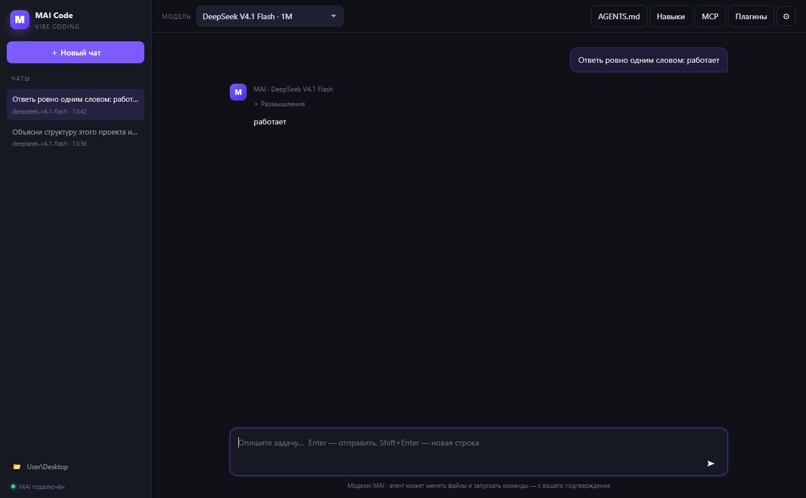

# MAI Code

Десктопный агент для вайбкодинга на моделях [MAI](https://api-ai.mai.ru) — собственный чат-клиент
на Electron с инструментами для работы с файлами, `AGENTS.md`, навыками, MCP-серверами и плагинами.



## Возможности

- **Модели MAI** — список подтягивается из `GET /v1/models`, в дропдауне только чат-модели
  с человеческими названиями и размером контекста.
- **Чат с агентом** — потоковые ответы, блок «Размышления», история чатов, переключение сессий,
  остановка генерации.
- **Инструменты агента**:
  - `read_file`, `list_files`, `grep` — чтение проекта;
  - `write_file`, `edit_file` — правки (с подтверждением);
  - `run_shell` — команды в папке проекта (с подтверждением, таймаут 180 с);
  - `load_skill` — загрузка навыка по имени;
  - `mcp__<server>__<tool>` — инструменты MCP-серверов;
  - инструменты из плагинов.
- **AGENTS.md** — проектный и глобальный, подмешиваются в системный промпт.
- **Навыки** — `<проект>/.mai-code/skills/<имя>/SKILL.md`, создание и удаление из интерфейса.
- **MCP** — локальные (stdio) и удалённые (streamable HTTP) серверы.
- **Плагины** — `<проект>/.mai-code/plugins/*.js`: свои инструменты и хук `transformMessages`.
- **Изоляция путей** — инструменты работают только внутри папки проекта, пока не включён
  доступ вне проекта.

## Быстрый старт

Требования: Windows 10/11, Node.js 20+.

```powershell
git clone https://github.com/crruton/mai-code.git
cd mai-code
npm.cmd install
npm.cmd start
```

> В PowerShell `npm` может блокироваться политикой выполнения — используйте `npm.cmd`.
> Если npm 11 не запускает install-скрипты Electron:
> `npm.cmd install-scripts approve electron` и `npm.cmd rebuild electron`.

Ярлык на рабочем столе:

```powershell
powershell -ExecutionPolicy Bypass -File .\install-shortcut.ps1
```

### Ключ и адрес шлюза

При первом запуске приложение берёт ключ из `mai-api-key.txt` рядом с проектом (если файл есть),
дальше ключ хранится в `%APPDATA%\mai-code\settings.json` и задаётся через шестерёнку.

| Параметр | Значение по умолчанию |
|---|---|
| Base URL | `https://api-ai.mai.ru/v1` |
| Модель | `deepseek-v4.1-flash` |
| Температура | `0.3` |
| Максимум шагов агента | `30` |

### Корпоративные сертификаты

Шлюз MAI использует корпоративный корневой сертификат, которого нет в стандартном наборе Node.
Приложение при старте само перезапускается с флагом `--use-system-ca` через `NODE_OPTIONS`,
поэтому вручную ничего настраивать не нужно.

## Где что лежит

| Что | Путь |
|---|---|
| Настройки | `%APPDATA%\mai-code\settings.json` |
| Чаты | `%APPDATA%\mai-code\sessions.json` |
| Глобальные навыки | `%APPDATA%\mai-code\skills\` |
| Глобальный AGENTS.md | `%APPDATA%\mai-code\AGENTS.md` |
| Глобальные плагины | `%APPDATA%\mai-code\plugins\` |
| Навыки проекта | `<проект>/.mai-code/skills\` |
| Плагины проекта | `<проект>/.mai-code/plugins\` |

## Плагин: пример

```js
export default {
  name: 'example-plugin',
  tools: [
    {
      schema: {
        type: 'function',
        function: {
          name: 'project_time',
          description: 'Текущее время',
          parameters: { type: 'object', properties: {} },
        },
      },
      async run() {
        return new Date().toLocaleString('ru-RU');
      },
    },
  ],
};
```

Кнопка «Создать пример» в панели «Плагины» кладёт такой файл в проект.

## MCP: пример

```json
{
  "mcpServers": {
    "filesystem": {
      "command": "npx",
      "args": ["-y", "@modelcontextprotocol/server-filesystem", "C:\\work\\project"]
    }
  }
}
```

Добавляется через панель «MCP» (имя + команда + аргументы) или правится в `settings.json`.

## Документация

- [Архитектура](docs/ARCHITECTURE.md) — слои, IPC, цикл агента, инструменты.
- [Каталог моделей MAI](docs/mai-models.md) — 16 моделей, контексты, примеры запросов.
- [Провайдеры и рантаймы](docs/PROVIDERS.md) — как подключать другие модели и агентов.
- [Планы](docs/ROADMAP.md) — что дальше.

## Ограничения

- Инструменты работают только внутри папки проекта, если не включён доступ вне проекта.
- Каждая запись файла и каждая команда оболочки требуют подтверждения.
- Контекст длинного чата обрезается по размеру — старые ходы удаляются.
- Приложение пока запускается из папки, установщика нет.

## Безопасность

Ключи и токены не попадают в репозиторий: `.env`, `*.key`, `mai-api-key.txt`, `settings.json`
и `sessions.json` в `.gitignore`. Ключ MAI хранится локально в `%APPDATA%`.

## Лицензия

[MIT](LICENSE)
